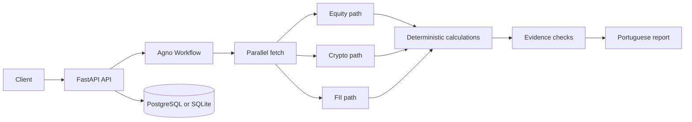

# AssetMind AI

AssetMind AI é uma plataforma open source de análise financeira multiagente. O cálculo é determinístico. O modelo de linguagem, quando usado, só narra evidências que o código já produziu.

AssetMind AI is an open-source financial analysis platform. Market math stays in Python. Agno workflows decide the order of work. A language model is optional and is not allowed to invent prices, filings, or probabilities.

This repository is the implementation behind a three-part engineering series: conception, technical decisions, and a public demonstration. It is a modular monolith with a tested HTTP API, not a chat prototype and not a trading system.

## Implementation status

Verified in this workspace on 4 Nov 2026:

- The test suite passes with coverage above 85% for the package.
- Ruff and Pyright pass on `src`.
- `GET /health` and an authenticated fixture analysis for equity, crypto, and FII run through an Agno 3.1.12 `Workflow`.
- Live HTTP 200 responses were received from brapi (`PETR4` quote), Banco Central SGS series 432, and CoinGecko (`bitcoin` markets). Those calls are not part of the default test suite.
- The Docker image `assetmind-ai:local` built, then answered `/health`, `/ready`, and a fixture analysis for equity, crypto, and a FII. A Render deploy was not executed. `render.yaml` is authored and still needs a real deploy before anyone calls hosting production-ready.

Not implemented:

- Live parsing of CVM monthly FII filings. Fixture mode supplies labeled sample facts. Live mode leaves those fundamentals missing.
- A public AgentOS control plane. It stays off unless `ASSETMIND_AGENTOS_ENABLED=true` and a JWT secret is set.
- Redis, background workers, broker execution, vector search, and RAG.
- Calibrated return forecasts. Bear, base, and bull figures are assumptions.

## Architecture



The domain package does not import Agno, FastAPI, or a data vendor. Providers sit behind adapters. Specialist stages are workflow steps with Python executors. Agno `Agent` objects exist for an optional narrative, and the default run does not call them.

## Asset classes

| Class | Examples | What the MVP calculates |
| --- | --- | --- |
| Equity | `PETR4` | Close, return, volatility, drawdown, moving average, in-sample buy-and-hold |
| Crypto | `bitcoin` | The same price statistics with a 365-period volatility convention, plus market cap and volume when present |
| Real estate | `HGLG11` with `asset_class=real_estate` | FII quota prices, and fixture fundamentals when fixture mode is on |

Tickers ending in `11` are ambiguous on B3. The API asks for `asset_class` instead of guessing between an equity unit and a FII. Vacancy is applied only to brick funds. Paper funds keep credit and indexer notes, and a vacancy number is not turned into a metric.

## Technology

Python 3.13, Agno 3.1.12, FastAPI, Pydantic v2, OpenRouter (optional), PostgreSQL, SQLAlchemy 2, Alembic, HTTPX, NumPy, pandas, uv, Ruff, Pyright, pytest, Docker, GitHub Actions, Render.

Redis is intentionally absent. One web process is enough for the current execution model.

## Getting started

```bash
uv sync --all-groups
cp .env.example .env
# Set ASSETMIND_API_KEY and keep ASSETMIND_PROVIDER_MODE=fixtures for an offline demo.
uv run pytest
uv run uvicorn assetmind.main:app --host 0.0.0.0 --port 8000
```

Fixture mode uses synthetic prices. Do not describe those numbers as market quotes.

## Configuration

See `.env.example`. Production on Render should set `ASSETMIND_DATABASE_URL` from the managed Postgres connection string. The application rewrites `postgres://` to `postgresql+psycopg://`.

Write endpoints require `X-API-Key`. Health and readiness do not.

Default guardrails for one basic analysis, before scaling by asset count:

| Limit | Default |
| --- | --- |
| Total estimated LLM tokens | 4000, multiplied by the number of assets |
| Narrative output tokens | 1200 |
| LLM calls | 8 |
| Provider calls | 12, multiplied by the number of assets |
| Estimated LLM cost | USD 0.03, multiplied by the number of assets |

These are engineering guardrails. They are not measured production costs. Estimated tokens and actual provider usage are stored separately. Crossing a budget stops the run and returns a partial result when any asset already has metrics.

## Example

```bash
curl -s http://localhost:8000/health

curl -s http://localhost:8000/api/v1/analyses \
  -H "X-API-Key: $ASSETMIND_API_KEY" \
  -H "Content-Type: application/json" \
  -d '{"assets":[{"symbol":"PETR4"},{"symbol":"bitcoin","asset_class":"crypto"},{"symbol":"HGLG11","asset_class":"real_estate"}]}'
```

Progress is available as Server-Sent Events at `GET /api/v1/analyses/{id}/events`.

## Tests

```bash
uv run ruff check src tests migrations
uv run pyright
uv run pytest
```

The default suite does not call a paid model or a live market API. External payloads are fixtures or an HTTPX mock transport.

## Data sources

| Source | Role | Constraint |
| --- | --- | --- |
| [brapi](https://brapi.dev) | B3 quotes and daily history | Free plan is limited. `PETR4`, `VALE3`, `MGLU3`, and `ITUB4` can be queried without a token. Free access is not a redistribution license. |
| [CoinGecko](https://www.coingecko.com/en/api) | Crypto market data | Public API is rate limited. |
| [Banco Central SGS](https://dadosabertos.bcb.gov.br) | Selic target, series 432 | Macro context for paper FIIs, not a fund fact. |
| CVM open data | FII filings | The monthly informe is not parsed yet. |

Missing numbers stay missing. They are never replaced with zero. A stale close is kept as evidence and is not reused as the current reference price.

## Cost control

Deterministic code handles routing, fetching, and math. The report composer copies those results into Brazilian Portuguese and does not copy provider prose, which also blocks instruction-like text in source payloads. OpenRouter is used only if an operator later wires a narrative call. The checked-in path does not spend model tokens.

## Limitations

- Search uses a small local catalog.
- Analyses run inside the request. There is no durable job queue.
- Scenario shocks default to -15%, 0%, and +15% and are labeled illustrative assumptions, not forecasts.
- Volatility annualization uses 252 periods for B3 names and 365 for crypto. That is a convention.
- No latency, accuracy, or hosting-cost measurement is claimed beyond the checks listed above.

## Roadmap

1. Parse CVM FII informes with explicit source timestamps.
2. Optional OpenRouter narrative behind the existing budget manager.
3. Validate the Render blueprint with a real deploy.
4. Consider Agno durable execution only after a job no longer fits the request.

## Contributing

Read [CONTRIBUTING.md](CONTRIBUTING.md) and `AGENTS.md`. Architectural changes belong in `docs/adr`.

## Disclaimer

Material educacional. Não é recomendação de investimento, oferta ou promessa de retorno. Cenários não são previsões com probabilidade calibrada.

Educational material only. Nothing in this repository is investment advice, an offer, or a promise of return.
