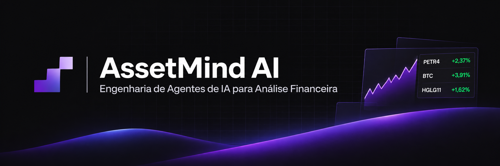
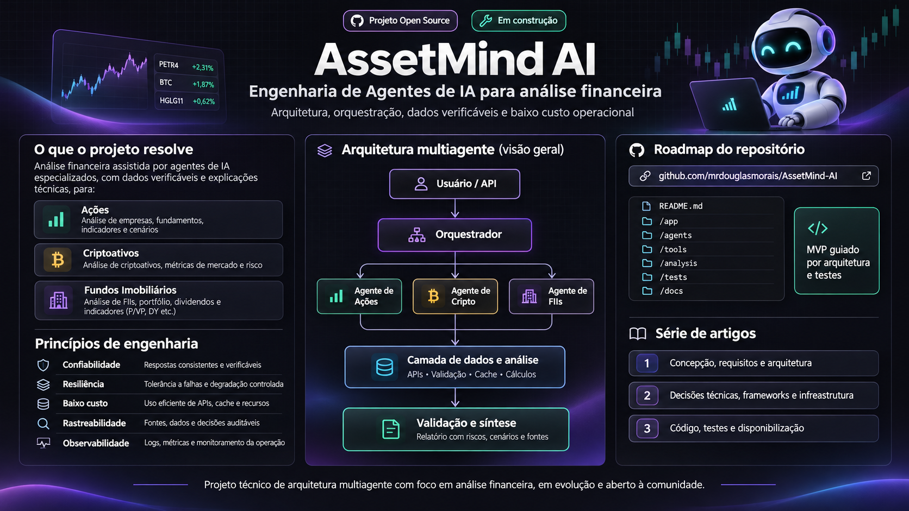
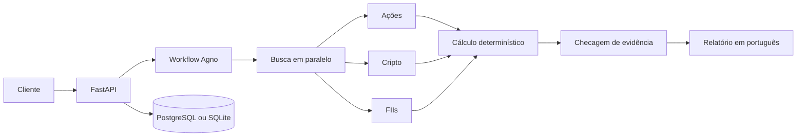

<p align="center">
  
</p>

<p align="center">
  <a href="https://github.com/mrdouglasmorais/AssetMind-AI">Open source</a>
  ·
  <a href="docs/architecture/overview.md">Arquitetura</a>
  ·
  <a href="docs/api/http.md">API</a>
  ·
  <a href="docs/adr">ADRs</a>
  ·
  <a href="docs/tutorials/first-analysis.md">Primeira análise</a>
</p>

AssetMind AI é uma plataforma open source de análise financeira. Agentes e workflows do [Agno](https://docs.agno.com) organizam o trabalho. Python calcula retorno, volatilidade, drawdown e cenários. O relatório em português só repete números que o código já produziu, com fonte e horário.

AssetMind AI is an open-source financial analysis platform for engineers who want to study agent orchestration, context control, evidence, and cost limits. It is the implementation behind a three-part engineering series: conception, technical decisions, and a public demonstration.

The figures on the banner (`+2,37%`, `+3,91%`, `+1,62%`) are part of the artwork. They are not quotes, not measurements from this repository, and not forecasts.

## O que o projeto resolve

Uma análise pede até cinco ativos e devolve um relatório educacional com evidência rastreável. O público é quem quer ler a arquitetura, rodar os testes e chamar a API.

| Classe | Exemplo | O que o MVP calcula |
| --- | --- | --- |
| Ações | `PETR4` | Fechamento, retorno, volatilidade, drawdown, média móvel e buy-and-hold dentro da amostra |
| Cripto | `bitcoin` | As mesmas estatísticas de preço, com volatilidade em 365 períodos, mais valor de mercado e volume quando existem |
| Fundos imobiliários | `HGLG11` com `asset_class=real_estate` | Preço da cota e, no modo fixture, fatos rotulados do fundo |

Um ticker da B3 terminado em `11` é ambíguo: pode ser unidade de ação ou cota de FII. A API pede `asset_class` em vez de adivinhar. Vacância entra só em fundo de tijolo. Fundo de papel guarda risco de crédito e indexador, e um número de vacância não vira métrica. FII, CRI e imóvel direto permanecem coisas diferentes.

## Visão do produto

<p align="center">
  
</p>

O cartaz resume a intenção do projeto: um orquestrador, três caminhos de análise, uma camada de dados e um relatório com fontes. A pasta desenhada no cartaz é um mapa visual. O código vive em `src/assetmind/`, com as specs em `specs/` e as decisões em `docs/adr/`.

No código, os três especialistas do cartaz são passos de um `Workflow` do Agno. Quem calcula é uma função Python. Objetos `Agent` existem para uma narrativa opcional e o caminho padrão não os chama. O rótulo "Em construção" do cartaz continua válido para o parsing ao vivo da CVM e para o deploy no Render.



O pacote `domain` não importa Agno, FastAPI nem SDK de provedor. Cada fonte externa passa por um adapter. Estados da execução: `created`, `validating`, `planning`, `fetching`, `analyzing`, `verifying` e `completed`, com saídas explícitas em `partial`, `failed` e `cancelled`.

## Cinco pilares

| Pilar | Onde vive | Papel |
| --- | --- | --- |
| Harness | `harness/` e `src/assetmind/application/` | Prazo, retry, orçamento, estado e falha parcial |
| Skills | `skills/` | Procedimentos dos agentes financeiros em tempo de execução |
| Context | `context/` e `application/context.py` | Só o resumo que a etapa precisa |
| Specs | `specs/` | Contratos e critérios de aceitação |
| Rules | `.cursor/rules/` e `rules/` | Padrões de código e regras de análise |

As skills em `.cursor/skills/` orientam o agente que escreve este repositório. As skills em `skills/` descrevem análise de ação, cripto, FII, cenário e evidência. Uma não substitui a outra.

## Stack

| Camada | Escolha |
| --- | --- |
| Linguagem | Python 3.13, com suporte declarado a 3.12 |
| Orquestração | Agno 3.1.12: `Workflow`, `Step` e `Parallel` |
| API | FastAPI e Pydantic v2 |
| Modelos | Groq no chat quando `GROQ_API_KEY` está definida; sem a chave o relatório sai direto. A sessão é fatiada e, com `ASSETMIND_EMBEDDING_PROVIDER=groq`, embutida por `nomic-embed-text-v1.5` |
| Dados | PostgreSQL em produção, SQLite para desenvolvimento e testes |
| Migrações | SQLAlchemy 2 e Alembic |
| HTTP | HTTPX assíncrono |
| Cálculo | NumPy e pandas |
| Qualidade | pytest, Ruff e Pyright |
| Entrega | uv, Docker, GitHub Actions e um blueprint Render |

Redis não entra neste MVP. Um processo web dá conta do modelo de execução atual. Não há Kubernetes, fila ou um serviço por agente.

## Mapa do repositório

```text
src/assetmind/
  api/            HTTP, schemas e OpenAPI
  application/    caso de uso, orçamento, estado e relatório
  domain/         ativos, evidência, métricas e cenários
  workflows/      workflow Agno
  agents/         agentes opcionais, fora do caminho padrão
  providers/      brapi, CoinGecko, Banco Central e fixture da CVM
  persistence/    tabelas da aplicação
  security/       API key e limite de taxa
docs/
  adr/            decisões de arquitetura
  api/            contrato HTTP
  architecture/   visão do monólito
  assets/         banner e cartaz
  tutorials/      primeira análise
specs/            contratos
skills/           procedimentos de execução
.cursor/          regras e skills de desenvolvimento
```

## Como rodar

Pré-requisitos: [uv](https://docs.astral.sh/uv/), Python 3.12 ou 3.13, e `make`. Docker entra só nos alvos de imagem e Compose.

`make init` cria `.env` a partir de `.env.example` quando o arquivo ainda não existe, preenche `ASSETMIND_API_KEY` com `local-dev-key` se a linha estiver vazia, e instala as dependências. Essa chave vale para a máquina local. Troque-a antes de qualquer ambiente compartilhado. O modo padrão continua `fixtures`: os preços são séries sintéticas, não cotação.

```bash
make init
make watch
```

`make watch` sobe a API em [http://127.0.0.1:8000](http://127.0.0.1:8000) e o [Agent UI](https://docs.agno.com/other/agent-ui) do Agno em [http://127.0.0.1:3000](http://127.0.0.1:3000). A interface recarrega com `src/`. Abrir `/`, `/docs` ou `/redoc` na API redireciona para o Agent UI. O Swagger não é servido. O esquema da API continua em `/openapi.json`. Outra porta da API: `make watch PORT=9000`. O passo a passo está em [docs/tutorials/first-analysis.md](docs/tutorials/first-analysis.md).

No chat, escreva um ativo do catálogo, por exemplo `PETR4`, `bitcoin` ou `HGLG11`. A resposta é o relatório determinístico. O token do Agent UI é o mesmo `ASSETMIND_API_KEY`, salvo se `ASSETMIND_OS_SECURITY_KEY` estiver definido. As rotas `/api/v1` continuam pedindo `X-API-Key`.

| Alvo | O que faz |
| --- | --- |
| `make help` | Lista os alvos |
| `make init` | Prepara `.env`, sincroniza o Python e instala o Agent UI |
| `make install` | `uv sync --all-groups` |
| `make ui-install` | Dependências do Agent UI |
| `make watch` | API com reload e Agent UI na porta 3000 |
| `make run` | API sem reload, com AgentOS ligado |
| `make test` | pytest |
| `make lint` | Ruff |
| `make format` | Formata com Ruff |
| `make typecheck` | Pyright |
| `make check` | Lint, formato, tipos, testes e varredura de segredos |
| `make migrate` | `alembic upgrade head` |
| `make secrets` | Varredura de segredos óbvios |
| `make build` | Imagem Docker `assetmind-ai:local` |
| `make up` | Compose com build: API e Postgres local |
| `make down` | Encerra o Compose |
| `make logs` | Acompanha o log da API no Compose |
| `make clean` | Remove cache local e o SQLite `assetmind.db` |

`make up` publica a API em `http://localhost:8000` com o Postgres do [docker-compose.yml](docker-compose.yml). A senha `assetmind` desse arquivo vale só para desenvolvimento. `make build` só constrói a imagem. Ela ainda não significa um deploy no Render.

## API

| Método | Caminho | Auth |
| --- | --- | --- |
| `GET` | `/health` | pública |
| `GET` | `/ready` | pública |
| `GET` | `/api/v1/assets/search?q=` | `X-API-Key`. `q` vazio lista o catálogo em `results` e `by_type` |
| `POST` | `/api/v1/analyses` | `X-API-Key` |
| `GET` | `/api/v1/analyses/{id}` | `X-API-Key` |
| `GET` | `/api/v1/analyses/{id}/events` | `X-API-Key`, SSE |
| `GET` | `/api/v1/analyses/{id}/report` | `X-API-Key` |

```bash
curl -s http://localhost:8000/health

curl -s http://localhost:8000/api/v1/analyses \
  -H "X-API-Key: $ASSETMIND_API_KEY" \
  -H "Content-Type: application/json" \
  -d '{
    "assets": [
      {"symbol": "PETR4"},
      {"symbol": "bitcoin", "asset_class": "crypto"},
      {"symbol": "HGLG11", "asset_class": "real_estate"}
    ]
  }'
```

A resposta traz `analysis_id`, `correlation_id` e `status`. Os status úteis são `completed`, `partial` e `failed`. Um resultado `partial` conserva o que já foi calculado e nomeia o limite ou a lacuna. O progresso gravado sai em `GET /api/v1/analyses/{id}/events`.

Símbolo inválido e ticker ambíguo respondem `422`. Chave ausente responde `401`. O limite em memória responde `429`. O contrato completo está em [specs/api-contracts.md](specs/api-contracts.md) e [docs/api/http.md](docs/api/http.md).

## Configuração e custo

As variáveis estão em [.env.example](.env.example). Em produção, `ASSETMIND_DATABASE_URL` pode chegar como `postgres://`; a aplicação reescreve o esquema para `postgresql+psycopg://`.

Guardrails de uma análise básica, antes de multiplicar pelo número de ativos:

| Limite | Padrão | Escala com os ativos |
| --- | --- | --- |
| Tokens estimados | 4000 | sim |
| Tokens de saída da narrativa | 1200 | não |
| Chamadas de modelo | 8 | não |
| Chamadas de provedor | 12 | sim |
| Custo estimado de modelo | USD 0,03 | sim |

São limites de engenharia, não custo medido em produção. Uso estimado e uso real ficam em campos separados. Estourar o orçamento encerra a rodada e devolve resultado parcial quando alguma métrica já existe.

O caminho versionado faz roteamento, busca e conta em Python. O compositor copia essas métricas para o português e deixa de fora o texto livre do provedor. Isso também impede que uma frase vinda da fonte entre no relatório como instrução. Com `GROQ_API_KEY`, o analista do Agent UI pede esse relatório a uma ferramenta e só pode repetir os números dela. Antes da chamada, a narração reserva tokens no teto da chamada e na franquia restante. A recusa acontece quando a reserva não cabe. A linha do ledger guarda a reserva em separado dos tokens que o modelo reportar. Uma consulta de manchetes entra como chamada de provedor, sem token de modelo. Sem a chave, a mesma resposta sai direto. A suíte de testes não gasta token pago.

## Fontes de dados

| Fonte | Papel | Limite conhecido |
| --- | --- | --- |
| [brapi](https://brapi.dev) | Cotações e histórico diário da B3 | Plano gratuito restrito. `PETR4`, `VALE3`, `MGLU3` e `ITUB4` podem ser consultados sem token. Acesso gratuito não é licença de redistribuição. |
| [CoinGecko](https://www.coingecko.com/en/api) | Mercado de cripto | API pública com limite de taxa. |
| [Banco Central SGS](https://dadosabertos.bcb.gov.br) | Meta Selic, série 432 | Contexto macro para FII de papel. Não é fato do fundo. |
| Dados abertos da CVM | Informes de FII | O informe mensal ainda não é interpretado. |

Cada observação guarda provedor, URL quando existe, instante observado e instante da coleta. Número ausente continua ausente. Fechamento vencido permanece como histórico e não vira preço de referência. Detalhe em [context/data-sources.md](context/data-sources.md).

## Testes

```bash
make check
```

O mesmo conjunto, separado: `make lint`, `make typecheck` e `make test`.

A suíte padrão usa fixtures e `MockTransport`. Ela não chama modelo pago nem API de mercado. A meta de cobertura do pacote é 85%.

Verificado neste workspace em 5 de novembro de 2026:

- Ruff, Pyright e pytest passaram. A cobertura ficou em 86,93%, com 83 testes.
- A imagem `assetmind-ai:local` respondeu `/health`, `/ready` e uma análise fixture de ação, cripto e FII, com zero chamadas de modelo.
- brapi (`PETR4`), a série 432 do Banco Central e o CoinGecko (`bitcoin`) responderam HTTP 200. Essas chamadas ficam fora da suíte.

## Deploy

O [Dockerfile](Dockerfile) escuta `0.0.0.0:$PORT`. O [render.yaml](render.yaml) descreve um web service e um Postgres no plano free, com health check em `/health` e AgentOS desligado. O blueprint foi escrito e ainda não foi publicado numa conta Render. Serviço free adormece após inatividade, e o Postgres free expira. Nenhum preço em dólar é afirmado aqui.

## Estado e limites

Implementado: domínio, adapters, motor quantitativo, workflow Agno, orçamento, API autenticada, persistência, testes, Docker e a documentação desta página.

Ainda em aberto:

- Leitura do informe mensal da CVM. No modo `live`, fundamentos do FII ficam ausentes. No modo `fixtures`, os fatos de amostra vêm rotulados.
- Plano de controle do AgentOS. Ele só sobe com `ASSETMIND_AGENTOS_ENABLED=true` e um segredo JWT.
- Fila durável. A análise corre dentro do request.
- Previsão com probabilidade calibrada. Os choques padrão são -15%, 0% e +15%, marcados como premissa ilustrativa.
- Deploy validado no Render, latência medida e custo medido de hospedagem.

Volatilidade anualizada usa 252 períodos na B3 e 365 em cripto. É convenção de amostragem.

## Roteiro

1. Interpretar informes de FII da CVM com carimbo de fonte.
2. Colar `GROQ_API_KEY` e reiniciar o `make watch` para o chat passar pelo Groq.
3. Publicar o blueprint no Render e registrar o que aconteceu.
4. Avaliar execução durável do Agno só quando uma análise deixar de caber no request.

A série de artigos acompanha essa ordem: concepção e arquitetura, decisões e infraestrutura, implementação e demonstração.

## Contribuir

Leia [CONTRIBUTING.md](CONTRIBUTING.md), [AGENTS.md](AGENTS.md) e [SECURITY.md](SECURITY.md). Mudança de arquitetura ganha um ADR em [docs/adr](docs/adr). Não commite `.env` nem apresente preço de fixture como cotação.

## Aviso

Material educacional. Não é recomendação de investimento, oferta ou promessa de retorno. Cenário não é previsão com probabilidade calibrada.

Educational material only. Nothing in this repository is investment advice, an offer, or a promise of return.
